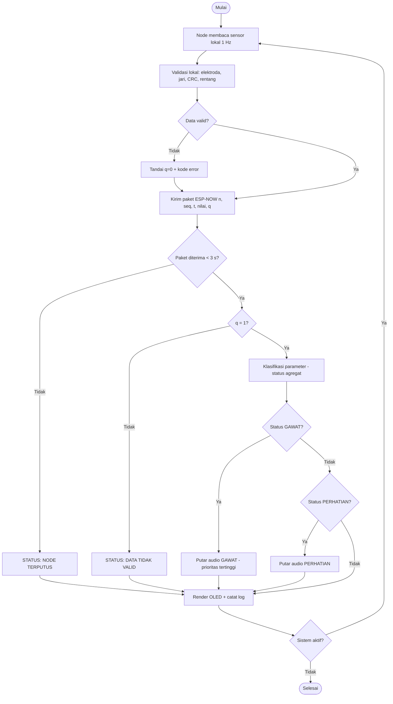

# Lampiran Teknis — Aturan Keputusan, Flowchart, dan Desain

**Melengkapi:** PRD Sistem Monitoring Parameter Fisiologis Berbasis ESP32 v0.1
**Tanggal:** 19 Oktober 2026
**Penyusun:** AViSha Inovasi Indonesia
**Status:** Usulan teknis — butuh persetujuan pemesan sebelum implementasi

> **Batas dokumen.** Semua angka pada dokumen ini adalah **usulan** yang disertai
> rujukan umum, bukan protokol klinis, bukan hasil pengujian, dan bukan alat
> diagnosis. Ambang di bawah berlaku untuk **dewasa saat istirahat** — tidak
> berlaku untuk anak, bayi, ibu hamil, atau kondisi akut tertentu.

---

## 1. Cara Kerja Sistem

Sistem terdiri dari **4 unit alat**: tiga node sensor dan satu controller. Enam
langkah berikut berulang terus selama alat menyala:

1. **Node membaca sensor.** Tiap node punya satu sensor. Node membaca 1× per
   detik, lalu memvalidasi pembacaan secara lokal: elektroda menempel atau
   lepas, jari ada di sensor atau tidak, CRC suhu benar atau tidak, nilai masuk
   rentang teknis atau tidak.
2. **Node mengirim paket.** Paket berisi identitas node, nomor urut, waktu, nilai
   sensor, dan satu flag validitas. Dikirim lewat ESP-NOW, 1× per detik.
3. **Controller memeriksa kesegaran data.** Kalau tidak ada paket dari sebuah
   node selama 3 detik, node itu ditandai **TERPUTUS** dan nilai terakhirnya
   **tidak dipakai** sebagai data terkini.
4. **Controller mengklasifikasi.** Hanya data dengan flag valid = 1 yang
   diklasifikasi. Hasil per parameter digabung menjadi satu status sistem dengan
   aturan prioritas.
5. **Controller menampilkan dan berbunyi.** Status ditampilkan di OLED. Kalau
   status memicu audio, DFPlayer memutar track yang sesuai.
6. **Controller mencatat.** Setiap perubahan status dan setiap paket dicatat
   (Serial, dan opsional microSD terpisah) sebagai bahan paper.

**Prioritas status sistem** (yang paling tinggi menang):

```
TERPUTUS  >  TIDAK VALID  >  GAWAT  >  PERHATIAN  >  NORMAL
```

Artinya: kalau Node 1 terputus sementara Node 2 menunjukkan gawat, layar
menampilkan keduanya, tetapi audio yang diputar adalah audio gawat. Kehilangan
data tidak boleh menutupi kondisi bahaya, dan kondisi bahaya tidak boleh
menyamarkan bahwa ada node yang mati.

---

## 2. Keputusan Teknis yang Diusulkan

Beberapa hal ini belum diputuskan di PRD. Saya ajukan pilihan beserta alasannya —
silakan setujui atau ganti.

### 2.1 Daftar alat — 4 unit

Sistem ini terdiri dari **4 unit alat fisik**, bukan 3. Tiga node sensor dan satu
controller — masing-masing punya ESP32, catu daya, dan casing sendiri.

| Unit | Peran | MCU | Sensor / aktuator | Catu daya | Casing |
|---|---|---|---|---|---|
| **Alat 1** — Node 1 | Akuisisi ECG | ESP32 | AD8232 + 3 elektroda | Charging/power node 1 | Box node |
| **Alat 2** — Node 2 | Akuisisi SpO2/HR | ESP32 | MAX30102 | Charging/power node 2 | Box node |
| **Alat 3** — Node 3 | Akuisisi suhu | ESP32 | DS18B20 | Charging/power node 3 | Box node |
| **Alat 4** — Controller | Penerima, tampilan, audio, log | ESP32 | OLED, DFPlayer + microSD + speaker, tombol, LED | Power Box Utama | Box utama |

Konsekuensi yang perlu dihitung sejak awal:

- **Firmware tetap dua build, bukan empat.** Satu firmware node di-flash tiga kali
  dengan `NODE_ID` berbeda (1, 2, 3), plus satu firmware controller.
- **Empat catu daya terpisah** harus siap sebelum uji integrasi. Invoice hanya
  menyebut unit charging/power tanpa baterai — jadi keempat alat belum bisa
  dinyalakan bersamaan sampai sumber dayanya diputuskan.
- **Controller harus mengenali tiga MAC node.** Usulan: tabel MAC di firmware,
  dengan tombol pairing untuk mendaftarkan node baru tanpa kompilasi ulang.
- **Empat box, bukan dua.** 3 box node + 1 box utama. Kalau ketiga node memakai
  desain yang sama, cukup satu file 3D yang dicetak tiga kali — ini juga alasan
  pertanyaan nomor 7 di §11.

### 2.2 Alokasi sensor ke node

| Node | Sensor | Parameter yang dikirim | Catatan |
|---|---|---|---|
| Node 1 | AD8232 | Status elektroda, HR turunan (R-peak), amplitudo puncak | 3 elektroda: RA, LA, RL |
| Node 2 | MAX30102 | HR, SpO2, status jari | I2C, butuh kontak stabil |
| Node 3 | DS18B20 | Suhu (°C), status CRC | Probe aksila/permukaan |

Ini pemetaan 1:1 yang paling wajar dari invoice (3 sensor, 3 node). Kalau
pemesan ingin node ketiga sebagai cadangan, cukup satu node tidak diisi — tidak
mengubah firmware controller.

### 2.3 Yang dikirim: nilai turunan, bukan waveform ECG

**Usulan: kirim HR, SpO2, suhu, dan status validitas — bukan waveform ECG mentah.**

Alasannya:
- OLED 128×64 tidak mungkin menampilkan trace ECG yang berguna.
- Waveform 250 Hz × 3 node tidak muat nyaman di satu kanal ESP-NOW bersama data lain.
- Untuk paper, angka + tren + tabel status sudah cukup kuat; waveform menambah
  klaim yang tidak bisa dipertanggungjawabkan tanpa validasi.

Kalau pemesan tetap ingin waveform, itu pekerjaan tambahan (P2): kirim *burst*
500 sampel hanya saat tombol ditekan, bukan streaming terus-menerus.

### 2.4 Protokol dan laju data

| Item | Usulan | Alasan |
|---|---|---|
| Protokol | ESP-NOW | Tanpa router, latensi rendah, cocok 3 node |
| Laju kirim | 1 paket/detik per node | Cukup untuk parameter vital, payload kecil |
| Timeout | 3 detik (3 paket hilang) | Toleran terhadap 1–2 paket hilang |
| Ukuran payload | ± 40 byte (struct biner) | Jauh di bawah batas 250 byte ESP-NOW |
| Kanal | 2.4 GHz kanal 1 (samakan semua perangkat) | Menghindari node tidak saling menemukan |

---

## 3. Lampiran A — Tabel Aturan Keputusan (Terisi)

### 3.1 Aturan validitas (dijalankan sebelum klasifikasi)

| Sensor | Syarat data dianggap VALID | Kalau gagal |
|---|---|---|
| AD8232 | `LO+` dan `LO-` tidak HIGH selama 1 detik | `q=0`, kode error `E1` (elektroda lepas) |
| MAX30102 | Jari terdeteksi, amplitudo PPG cukup, HR 30–220 bpm stabil 5 detik | `q=0`, kode error `E2` (sinyal PPG buruk) |
| DS18B20 | CRC cocok, nilai 30,0–43,0 °C | `q=0`, kode error `E3` (suhu tidak terbaca) |
| Semua | Nilai tidak `NaN` dan tidak di luar rentang teknis | `q=0`, kode error `E9` |

### 3.2 Tabel keputusan per parameter

| Parameter | Satuan | Kondisi IF | Status | Tampilan OLED | Audio | Rujukan |
|---|---|---|---|---|---|---|
| HR | bpm | `< 50` | **BRADIKARDIA BERAT** | `HR 45 !!!` | A-03 | AHA — bradikardia < 60 bpm |
| HR | bpm | `50 – 59` | BRADIKARDIA | `HR 55 !` | A-02 | AHA — bradikardia < 60 bpm |
| HR | bpm | `60 – 100` | NORMAL | `HR 78` | — | AHA — 60–100 bpm |
| HR | bpm | `101 – 120` | TAKIKARDIA | `HR 112 !` | A-02 | AHA — takikardia > 100 bpm |
| HR | bpm | `> 120` | **TAKIKARDIA BERAT** | `HR 134 !!!` | A-03 | AHA — takikardia > 100 bpm |
| SpO2 | % | `≥ 95` | NORMAL | `SpO2 97%` | — | WHO — ≥ 95% normal |
| SpO2 | % | `91 – 94` | HIPOKSIA RINGAN | `SpO2 93% !` | A-04 | WHO — 91–94% di bawah normal |
| SpO2 | % | `86 – 90` | **HIPOKSIA SEDANG** | `SpO2 88% !!!` | A-05 | WHO — ≤ 90% hipoksemia |
| SpO2 | % | `≤ 85` | **HIPOKSIA BERAT** | `SpO2 83% !!!` | A-05 | WHO — hipoksemia berat |
| Suhu | °C | `< 35,0` | **HIPOTERMIA BERAT** | `T 34.2 !!!` | A-07 | Rentang suhu inti normal 36,5–37,5 °C |
| Suhu | °C | `35,0 – 35,9` | HIPOTERMIA | `T 35.6 !` | A-06 | Hipotermia < 35 °C (aksila) |
| Suhu | °C | `36,0 – 37,4` | NORMAL | `T 36.6` | — | Aksila normal 36,0–37,4 °C |
| Suhu | °C | `37,5 – 37,9` | DEMAM RINGAN | `T 37.7 !` | A-08 | Demam ≥ 37,5 °C (aksila) |
| Suhu | °C | `38,0 – 39,4` | DEMAM | `T 38.6 !` | A-08 | Demam ≥ 38,0 °C |
| Suhu | °C | `≥ 39,5` | **DEMAM TINGGI** | `T 39.8 !!!` | A-09 | Demam tinggi ≥ 39,5 °C |
| ECG | — | `LO+` atau `LO-` HIGH > 1 s | **ELEKTRODA LEPAS** | `ECG: LEPAS` | A-10 | Panduan modul AD8232 |
| ECG | bpm | `\|HR_ECG − HR_PPG\| > 15` selama 5 s | HR TIDAK KONSISTEN | `HR: CEK SENSOR` | A-11 | Konsistensi dua metode |
| ECG | — | selain di atas | ECG TERBACA | `ECG: OK` | — | Tanpa interpretasi irama |
| Komunikasi | — | tidak ada paket `> 3 s` | **NODE TERPUTUS** | `N1: TERPUTUS` | A-12 | Batas desain sistem |
| Sistem | — | hanya 1 dari 3 node aktif `> 10 s` | SISTEM TIDAK LENGKAP | `1/3 NODE` | A-13 | Batas desain sistem |

**Catatan penting soal ECG.** Sistem ini **tidak** menginterpretasi irama jantung.
Satu lead tidak cukup untuk itu, dan klaim aritmia tidak boleh muncul di paper.
Yang dilaporkan hanya: elektroda terpasang/lepas, HR turunan, dan konsistensi HR
terhadap PPG.

### 3.3 Histeresis dan debounce

Ambang angka saja tidak cukup — nilai yang berayun di batas akan membuat status
berkedip dan audio berbunyi berulang. Aturan tambahan:

- Perubahan status hanya berlaku bila kondisi bertahan **≥ 3 detik** berturut-turut.
- Untuk keluar dari status GAWAT, nilai harus melewati ambang sebesar **margin
  2 satuan** (mis. HR turun di bawah 118 sebelum TAKIKARDIA BERAT dilepas).
- Nilai yang hilang tidak dihitung sebagai "normal" — nilainya dibekukan dan
  diberi tanda `--`.

---

## 4. Aturan Agregasi

```
status_sistem = NORMAL

untuk setiap node:
    jika umur_data > 3 detik      -> status_node = TERPUTUS      (q diabaikan)
    selain itu jika q == 0        -> status_node = TIDAK_VALID   (tidak diklasifikasi)
    selain itu                    -> status_node = klasifikasi_parameter(node)

status_sistem = status_terburuk(status_semua_node)
```

`status_terburuk` memakai urutan: `TERPUTUS > TIDAK_VALID > GAWAT > PERHATIAN > NORMAL`.

Kalau dua node saling bertentangan pada parameter yang sama (mis. HR dari PPG
normal tetapi HR dari ECG gawat), sistem menampilkan **HR TIDAK KONSISTEN** dan
tidak memicu audio gawat sampai selisihnya bertahan lebih dari 5 detik.

---

## 5. Peta Audio (DFPlayer)

Berkas disimpan di folder `mp3/` pada microSD, nama 4 digit: `0001.mp3` … `0013.mp3`,
MP3 mono 128 kbps 44,1 kHz.

| Kode | Berkas | Isi suara | Prioritas |
|---|---|---|---|
| A-01 | `0001.mp3` | "Sistem siap. Semua sensor terhubung." | 1 (info) |
| A-02 | `0002.mp3` | "Perhatian. Detak jantung tidak normal." | 2 |
| A-03 | `0003.mp3` | "Peringatan. Detak jantung sangat tidak normal. Segera cari bantuan." | 4 |
| A-04 | `0004.mp3` | "Perhatian. Kadar oksigen sedikit rendah." | 2 |
| A-05 | `0005.mp3` | "Peringatan. Kadar oksigen rendah. Segera cari bantuan." | 4 |
| A-06 | `0006.mp3` | "Perhatian. Suhu tubuh rendah." | 2 |
| A-07 | `0007.mp3` | "Peringatan. Suhu tubuh sangat rendah. Segera cari bantuan." | 4 |
| A-08 | `0008.mp3` | "Perhatian. Suhu tubuh meningkat." | 2 |
| A-09 | `0009.mp3` | "Peringatan. Suhu tubuh tinggi. Segera cari bantuan." | 4 |
| A-10 | `0010.mp3` | "Elektroda terlepas. Periksa pemasangan elektroda." | 3 |
| A-11 | `0011.mp3` | "Pembacaan detak jantung tidak konsisten. Periksa sensor." | 3 |
| A-12 | `0012.mp3` | "Node tidak terhubung. Periksa daya node." | 3 |
| A-13 | `0013.mp3` | "Sistem tidak lengkap. Sebagian node tidak aktif." | 3 |

**Aturan pemutaran:**

1. Hanya satu track diputar pada satu waktu.
2. Audio gawat (prioritas 4) **tidak boleh dipotong** oleh audio prioritas lebih rendah.
3. Kondisi yang sama tidak diulang sebelum **30 detik** berlalu.
4. Maksimal **3 kali** pengulangan per kondisi; setelah itu senyap sampai kondisi berubah.
5. Kembali ke NORMAL tidak memicu audio kecuali sebelumnya ada kondisi gawat.

---

## 6. Flowchart



Versi bergambar ada di `Lampiran Teknis.html`.

---

## 7. Diagram Blok

```text
                      ESP-NOW 2.4 GHz, 1 paket/detik
 [Alat 1] Node 1  AD8232   ────────┐
 [Alat 2] Node 2  MAX30102 ────────┼──> [Alat 4] Controller ESP32 ──> OLED 128x64
 [Alat 3] Node 3  DS18B20  ────────┘              │            ──> DFPlayer + Speaker
                                                  │            ──> Tombol + LED
                                                  └───────────> Log Serial / microSD
```

---

## 8. Pinout Usulan (ESP32 DevKit 30 pin)

> **Jangan dipatenkan sebelum board dan modul fisik diperiksa.** Tabel ini
> usulan berdasarkan batasan ESP32, bukan hasil verifikasi alat.

**Batasan yang wajib dipatuhi:**
- GPIO 34–39 **input saja**, tidak bisa jadi output.
- ADC yang bisa dipakai saat WiFi/ESP-NOW aktif hanya **ADC1 (GPIO 32–39)**.
- Hindari GPIO 6–11 (flash internal).
- GPIO 0, 2, 12, 15 adalah strapping pin — jangan dipakai untuk tombol yang
  ditekan saat boot.

### Node 1 — AD8232

| AD8232 | ESP32 | Keterangan |
|---|---|---|
| 3.3V | 3V3 | Jangan 5V |
| GND | GND | |
| OUTPUT | GPIO 34 | ADC1, input only |
| LO+ | GPIO 35 | Deteksi elektroda lepas |
| LO− | GPIO 32 | Deteksi elektroda lepas |
| SDN | 3V3 | Selalu aktif |

### Node 2 — MAX30102

| MAX30102 | ESP32 | Keterangan |
|---|---|---|
| VIN | 3V3 | Modul dengan regulator 1,8 V |
| GND | GND | |
| SDA | GPIO 21 | I2C default |
| SCL | GPIO 22 | I2C default |
| INT | GPIO 27 | Opsional, untuk baca berbasis interrupt |

### Node 3 — DS18B20

| DS18B20 | ESP32 | Keterangan |
|---|---|---|
| VDD | 3V3 | Mode parasit tidak dipakai |
| GND | GND | |
| DQ | GPIO 4 | **Pull-up 4,7 kΩ ke 3V3 wajib** |

### Controller

| Perangkat | ESP32 | Keterangan |
|---|---|---|
| OLED SDA | GPIO 21 | I2C |
| OLED SCL | GPIO 22 | I2C |
| DFPlayer TX | GPIO 16 | RX2 controller |
| DFPlayer RX | GPIO 17 | TX2, lewat resistor 1 kΩ seri |
| Tombol OK | GPIO 25 | INPUT_PULLUP |
| Tombol Next | GPIO 26 | INPUT_PULLUP |
| Tombol Mute | GPIO 33 | INPUT_PULLUP |
| LED status | GPIO 2 | Hijau: normal |
| LED alarm | GPIO 5 | Merah: gawat |

---

## 9. Format Data

Struct biner untuk ESP-NOW (hemat, ± 40 byte):

```c
typedef struct __attribute__((packed)) {
    uint8_t  node_id;    // 1..3
    uint16_t seq;        // naik terus, untuk deteksi paket hilang
    uint32_t t_ms;       // millis() node saat baca
    uint8_t  q;          // 1 = valid, 0 = tidak valid
    uint8_t  err;        // 0=ok, 1=elektroda lepas, 2=PPG buruk, 3=suhu, 9=umum
    int16_t  hr;         // bpm, -1 = tidak ada
    uint8_t  spo2;       // %, 0 = tidak ada
    int16_t  temp_x10;   // °C x10, -1 = tidak ada
    uint16_t vbat_mv;    // tegangan suplai
} NodePacket;
```

Versi JSON hanya untuk log dan paper, bukan untuk lalu lintas ESP-NOW:

```json
{"n":1,"seq":1234,"t":56789,"q":1,"err":0,"hr":78,"spo2":0,"temp":0,"vbat":4020}
```

---

## 10. Tambahan untuk Rencana Pengujian

PRD bagian 12 belum menyebut pembanding. Untuk paper, tanpa pembanding tidak ada
klaim akurasi yang boleh ditulis. Tambahan minimal:

| ID | Pengujian | Pembanding | Bukti |
|---|---|---|---|
| T-10 | Akurasi HR | Oximeter/HR meter komersial, 30 pasangan data | Tabel selisih, rata-rata, simpangan |
| T-11 | Akurasi SpO2 | Pulse oximeter komersial, 30 pasangan data | Tabel selisih |
| T-12 | Akurasi suhu | Termometer digital, 20 pasangan data | Tabel selisih |
| T-13 | Deteksi elektroda lepas | Lepas-pasang 10 kali | Jumlah terdeteksi / total |
| T-14 | Latensi end-to-end | Timestamp node vs controller | Rata-rata dan maksimum (ms) |
| T-15 | Jarak jangkau ESP-NOW | Uji per 5 m sampai gagal | Jarak maksimum stabil |

Catat juga: **jumlah subjek, kondisi ruangan, dan waktu pengujian** — tanpa itu
hasilnya tidak bisa diulang.

---

## 11. Yang Masih Harus Dikonfirmasi ke Pemesan

Tujuh hal, urut dari yang paling menghambat:

1. **Alokasi sensor per node** — setujui usulan 1:1 di §2.2?
2. **Sumber daya 4 alat** — invoice menyebut tanpa baterai. Tiap unit disuplai
   kabel, power bank, atau baterai terpisah? Ini menentukan klaim "wireless" dan
   apakah keempat alat bisa menyala bersamaan saat uji integrasi.
3. **Ambang di §3.2** — disetujui, atau ada angka dari pembimbing/rujukan tertentu?
4. **Subjek uji** — dewasa sehat, atau ada skenario pasien? Mempengaruhi etika dan klaim.
5. **Bahasa dan isi audio** — draf di §5 disetujui?
6. **Isi panduan first aid** — siapa yang menyusun dan menyetujui? Sistem hanya
   memutar audio; teks panduan ditampilkan di OLED atau dokumen terpisah?
7. **Tiga node identik atau berbeda?** Satu desain PCB yang sama untuk ketiga node
   (hanya sensor yang diganti) jauh lebih murah dan lebih cepat dirakit daripada
   tiga PCB berbeda. Ini mempengaruhi desain casing juga.

---

## 12. Rujukan

- American Heart Association — *Adult Basic and Advanced Life Support*, rentang
  denyut jantung dewasa saat istirahat (60–100 bpm; bradikardia < 60; takikardia > 100).
- World Health Organization — *Pulse Oximetry Training Manual*, interpretasi
  SpO2 dan batas hipoksemia.
- World Health Organization — *Integrated Management of Childhood Illness*,
  ambang demam (dirujuk hanya untuk definisi demam, bukan untuk anak).
- Analog Devices — *AD8232 Heart Rate Monitor Front End* datasheet, pin LO+/LO−
  dan perilaku leads-off.
- Maxim Integrated — *MAX30102 Pulse Oximeter and Heart-Rate Sensor* datasheet.
- Maxim Integrated — *DS18B20 Programmable Resolution 1-Wire Digital Thermometer*
  datasheet, waktu konversi dan akurasi.
- Espressif — *ESP-NOW User Guide*, batas payload dan karakteristik kanal.

> Nomor halaman dan edisi dokumen rujukan perlu dicocokkan ulang saat penulisan
> paper. Sitasi di atas menyebut dokumen, bukan kutipan verbatim.
