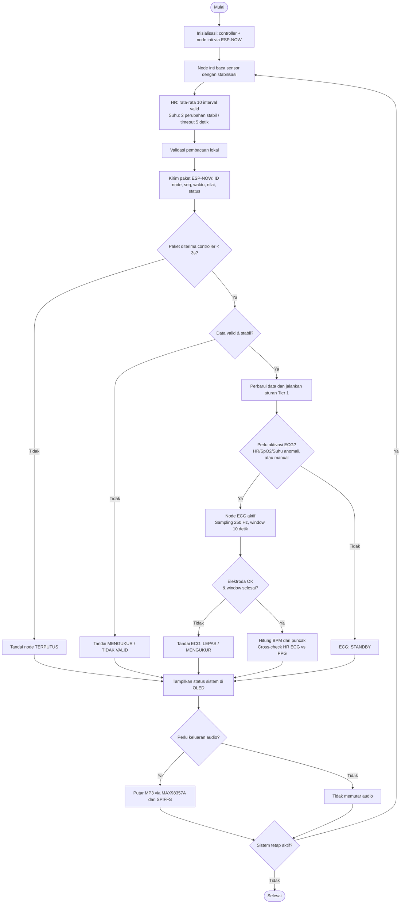

# PRD — Sistem Monitoring Parameter Fisiologis Berbasis ESP32

**Versi:** 0.5 (ESP-NOW terimplementasi dan terverifikasi build di 4 environment)  
**Tanggal:** 12 November 2026  
**Status:** Draft — ambang fisiologis, mekanisme aktivasi ECG, dan panduan first aid masih perlu dikonfirmasi. Lapisan transport ESP-NOW, stabilisasi sensor, OLED, dan audio MAX98357A sudah terimplementasi dan lulus kompilasi.  
**Penyusun:** AViSha Inovasi Indonesia  
**Referensi ruang lingkup:** Invoice #113 tanggal 2 Oktober 2026 dan percakapan kebutuhan proyek 14 Oktober – 11 November 2026

---

## Riwayat Revisi

| Versi | Tanggal | Perubahan |
|---|---|---|
| 0.1 | 19 Okt 2026 | Draft awal — 3 node paralel, semua wajib aktif |
| 0.2 | 11 Nov 2026 | Arsitektur modular berjenjang: node inti (HR + Suhu) wajib, node ECG opsional untuk analisa lanjut |
| 0.3 | 11 Nov 2026 | ESP-NOW ditetapkan sebagai protokol wireless final. Logika stabilisasi sensor ditambahkan: HR rata-rata 10 interval denyut valid, Suhu 3 baca stabil, ECG hitung puncak dalam window 10 detik. Audio via MAX98357A (bukan DFPlayer) |
| 0.4 | 12 Nov 2026 | Pembacaan suhu dipercepat: interval 1 detik, resolusi 11-bit, dua perubahan stabil atau fallback 5 detik |
| 0.5 | 12 Nov 2026 | ESP-NOW terimplementasi di keempat firmware (header bersama `include/espnow_common.h`). NodePacket 18 byte (packed). Callback recv IDF 5.x dengan guard versi. Controller: queue-based dispatch, timeout 3 detik, status STANDBY ECG, OLED, audio A-01/A-13. Semua 4 environment + SPIFFS image lulus kompilasi dan diuji upload oleh pengguna. Perbaikan: NODE_ID HR=1 (sebelumnya salah 2), BEATS_TO_AVERAGE=10 (sebelumnya 4). Library audio dikoreksi: ESP8266Audio (bukan ESP32-audioI2S). |

---

## 1. Ringkasan Proyek

Proyek ini bertujuan membuat prototipe sistem pemantauan parameter fisiologis berbasis ESP32 dengan arsitektur **modular berjenjang**. Sistem terdiri dari dua tier:

- **Tier 1 (Inti):** Node heart rate (MAX30102) dan node suhu (DS18B20) — selalu aktif, jadi pemantauan rutin.
- **Tier 2 (Lanjutan, opsional):** Node ECG (AD8232) — diaktifkan hanya ketika Tier 1 menunjukkan anomali yang membutuhkan analisa lebih lanjut.

Komunikasi antar node dan controller menggunakan **ESP-NOW** (protokol Espressif, tanpa router, latensi rendah). Controller menerima data dari node yang aktif, menampilkan informasi melalui OLED 128×64, serta memberikan keluaran audio melalui MAX98357A I2S amplifier + speaker. Prototipe menjalankan klasifikasi triase berbasis ambang usulan; panduan first aid klinis tetap memerlukan tinjauan dan persetujuan terpisah.

Dokumen ini menjadi acuan untuk menyusun flowchart, desain alat, aturan `if-else`, implementasi firmware, dan bahan teknis untuk paper. Detail yang belum dinyatakan pada sumber ditandai sebagai **perlu dikonfirmasi**, bukan dianggap sebagai spesifikasi final.

## 2. Latar Belakang dan Kebutuhan

Dalam percakapan tanggal 14 Oktober – 11 November 2026, pemesan meminta:
- Flowchart sistem.
- Desain alat.
- Aturan `if-else`.
- Hasil dan informasi teknis lain yang berkaitan dengan paper.

Paper disebut perlu dikumpulkan pada minggu setelah percakapan tersebut. Pembuatan alat fisik disebut masih memiliki waktu sekitar satu minggu.

**Alasan perubahan arsitektur (v0.2):** ECG dengan AD8232 membutuhkan elektroda menempel pada dada, yang tidak praktis untuk pemantauan rutin. Nilai utama ECG dalam sistem ini adalah sebagai **konfirmasi analisa** ketika heart rate dan/atau suhu sudah menunjukkan pembacaan abnormal. Membuat ECG opsional menyederhanakan penggunaan sehari-hari, mengurangi kompleksitas saat uji, dan tetap menyediakan kemampuan analisa lanjut saat dibutuhkan.

**Keputusan teknis v0.3:**
- **ESP-NOW** dipilih sebagai protokol wireless — tanpa router, latensi rendah, payload kecil, cocok untuk 2-3 node.
- **MAX98357A** dipilih untuk audio — I2S langsung, decode MP3 di firmware ESP32 via library ESP8266Audio (AudioGeneratorMP3, AudioFileSourceSPIFFS, AudioOutputI2S), tanpa DFPlayer/microSD terpisah. File MP3 disimpan di SPIFFS.
- **Logika stabilisasi** diterapkan di setiap sensor agar nilai yang dikirim ke controller sudah matang, bukan pembacaan mentah yang berayun.

**Implementasi prototipe controller:** Kesimpulan hanya dibuat setelah HR dari
rata-rata 10 interval denyut dan suhu stabil tersedia bersamaan. Ambang yang
dipakai adalah usulan dewasa saat istirahat pada Lampiran Teknis, bukan ambang
klinis yang telah disetujui. OLED/audio hanya memberi panduan triase
non-diagnostik; prototipe tidak menentukan pengobatan atau menggantikan tenaga
kesehatan.

## 3. Ruang Lingkup yang Tercantum

### 3.1 Termasuk dalam ruang lingkup

Berdasarkan invoice #113 (disesuaikan dengan arsitektur modular):
- 2 unit ESP32 Sensor Node Inti (HR + Suhu).
- 1 unit ESP32 Sensor Node ECG (opsional, diaktifkan sesuai kebutuhan).
- Sensor AD8232 dan kabel elektroda (untuk node ECG).
- Sensor MAX30102 (untuk node HR).
- Sensor DS18B20 (untuk node suhu).
- 1 ESP32 Controller Utama.
- OLED Display 128×64.
- MAX98357A I2S amplifier + speaker.
- File audio MP3 di SPIFFS (13 track, total ±480 KB).
- Charging/Power Node untuk node sensor (tanpa baterai).
- Power Box Utama (tanpa baterai).
- Tombol, LED, konektor, PCB, dan kabel internal.
- Komponen pendukung wireless.
- Perancangan sistem wireless ESP-NOW: node inti + controller (+ node ECG opsional).
- Pemrograman ESP32 Sensor Node dan Controller Utama.
- Integrasi komunikasi ESP-NOW.
- Integrasi sensor, OLED, dan sistem suara I2S.
- Decision logic dan panduan first aid.
- Perakitan, testing, debugging, penyempurnaan prototype.
- Desain dan 3D print box utama serta box node sensor.

### 3.2 Belum ditetapkan oleh sumber

Hal berikut belum dapat dianggap final:
- Kapan node ECG diaktifkan — apakah otomatis (dipicu sistem) atau manual (dipicu operator).
- Ambang batas tiap parameter.
- Logika klasifikasi status dan tindakan yang dipicu.
- Detail panduan first aid dan sumber klinisnya.
- Desain mekanik final dan dimensi casing.
- Durasi baterai dan spesifikasi baterai; invoice menyatakan bagian charging/power node dan power box utama **tanpa baterai**.
- Metode dan kriteria pengujian serta target kinerja numerik.

### 3.3 Sudah diputuskan (tidak lagi terbuka)

| Item | Keputusan | Dasar |
|---|---|---|
| Protokol wireless | ESP-NOW | Tanpa router, latensi rendah, payload kecil, cocok untuk 2-3 node |
| Modul audio | MAX98357A I2S + speaker | Decode MP3 di firmware via ESP8266Audio (AudioGeneratorMP3 + AudioFileSourceSPIFFS + AudioOutputI2S), file di SPIFFS |
| Arsitektur | Modular berjenjang (Tier 1 + Tier 2) | ECG opsional, aktif saat anomali |
| Sensor node inti | MAX30102 (HR/SpO2) + DS18B20 (Suhu) | Pemantauan rutin, non-invasif |
| Sensor node lanjutan | AD8232 (ECG) | Konfirmasi analisa, butuh elektroda |
| Format file audio | MP3 di SPIFFS, nama 4 digit `0001.mp3`–`0013.mp3` | Kompatibel dengan ESP8266Audio (AudioGeneratorMP3 + AudioOutputI2S) |

## 4. Tujuan Produk

1. Mengumpulkan pembacaan sensor dari node inti (HR, Suhu) secara terus-menerus.
2. Mengaktifkan node ECG untuk analisa lanjut ketika parameter inti menunjukkan anomali.
3. Mengirim data dari node ke controller utama via ESP-NOW.
4. Memvalidasi data yang diterima sebelum ditampilkan atau diproses.
5. Menampilkan nilai dan status sistem pada OLED.
6. Menghasilkan keluaran suara berdasarkan aturan yang sudah dikonfirmasi.
7. Menyediakan decision logic dan panduan first aid yang terdokumentasi.
8. Menyediakan dokumentasi teknis untuk mendukung penulisan paper, tanpa mengklaim hasil pengujian yang belum dilakukan.

## 5. Pengguna dan Pemangku Kepentingan

- **Pemesan/tim paper:** memerlukan flowchart, desain, aturan keputusan, dan deskripsi metode.
- **Pengembang perangkat keras:** merancang node sensor, controller, catu daya, dan casing.
- **Pengembang firmware:** mengimplementasikan pembacaan sensor, komunikasi ESP-NOW, tampilan, dan logika keputusan.
- **Penguji:** melakukan pengujian sensor, komunikasi, keluaran, dan integrasi.
- **Pengguna prototipe:** menggunakan alat sesuai petunjuk yang nantinya disepakati.

## 6. Arsitektur Sistem

### 6.1 Diagram konseptual

```text
Tier 1 — Node Inti (selalu aktif):
  [Node HR — MAX30102] ──┐
  [Node Suhu — DS18B20] ─┼── ESP-NOW 2.4 GHz ──> [Controller ESP32]
                         │         1 paket/detik       │
Tier 2 — Node Lanjutan:  │                            ├──> OLED 128×64
  [Node ECG — AD8232] ───┘                            ├──> MAX98357A + Speaker (I2S)
   (opsional, aktif saat                               ├──> Tombol + LED
    Tier 1 menunjukkan anomali)                       └──> Log Serial / microSD
```

### 6.2 Komunikasi ESP-NOW

| Item | Nilai | Alasan |
|---|---|---|
| Protokol | ESP-NOW | Tanpa router, latensi rendah, cocok untuk 2-3 node |
| Laju kirim | 1 paket/detik per node inti | Cukup untuk parameter vital, payload kecil |
| Laju kirim ECG | 1 paket/detik (heartbeat); BPM diperbarui per window 10 detik | Controller cepat mendeteksi node; ECG tetap menghitung BPM per window |
| Timeout | 3 detik (3 paket hilang) | Toleran terhadap 1-2 paket hilang |
| Ukuran payload | 18 byte (struct biner packed, `static_assert`) | Jauh di bawah batas 250 byte ESP-NOW |
| Kanal | 2.4 GHz kanal 1 (samakan semua perangkat) | Menghindari node tidak saling menemukan |
| MAC node inti | Wajib terdaftar di controller | Node inti yang tidak mengirim = TERPUTUS |
| MAC node ECG | Opsional terdaftar di controller | Node ECG yang tidak mengirim = STANDBY (bukan TERPUTUS) |

### 6.3 Penggunaan node ECG (opsional)

ECG bukan syarat operasi controller dan tidak diaktifkan otomatis oleh ambang
HR atau suhu. Jika digunakan, pemasangan elektroda dan interpretasi hasil harus
berada di bawah pengawasan tenaga kesehatan yang sesuai. Controller hanya
menampilkan status node dan HR turunan ECG; hasil ECG tidak mengubah klasifikasi
atau arahan Tier 1, dan tidak digunakan untuk mendiagnosis irama jantung.

Tanpa node ECG, controller tetap beroperasi penuh dengan data HR dan suhu.
ECG yang belum pernah terhubung ditampilkan sebagai `STANDBY (OPSIONAL)`;
heartbeat yang berhenti setelah node pernah terhubung ditampilkan sebagai
`STANDBY / OFFLINE`. Status tersebut bukan gangguan pada sistem inti dan tidak
boleh menyiratkan bahwa ECG normal.

### 6.4 Konsekuensi desain

- **Jumlah alat fisik:** minimum 3 unit (controller + 2 node inti), maksimum 4 unit (+ node ECG).
- **Firmware:** 4 build terpisah di `platformio.ini`, satu per board (lihat §6.5). Masing-masing node punya kode pembacaan sensor berbeda, sehingga tidak bisa memakai satu biner node yang sama untuk ketiganya. Controller berbeda lagi karena menangani ESP-NOW receive, OLED, dan audio I2S.
- **Catu daya:** minimum 3 unit untuk operasi dasar (controller + 2 node inti). Node ECG butuh catu daya terpisah saat diaktifkan.

### 6.5 Konfigurasi Build (PlatformIO)

`platformio.ini` memuat 4 environment — satu untuk setiap ESP32 fisik:

| Environment | Board | File source | Library utama | Keterangan |
|---|---|---|---|---|
| `node_hr` | Node Inti 1 | `src/node_hr.cpp` | SparkFun MAX3010x | HR + SpO2, Tier 1 wajib |
| `node_suhu` | Node Inti 2 | `src/node_suhu.cpp` | OneWire, DallasTemperature | Suhu + stabilisasi, Tier 1 wajib |
| `node_ecg` | Node Lanjutan | `src/node_ecg.cpp` | — (ADC bawaan) | ECG window 10 detik, Tier 2 opsional |
| `controller` | Controller | `src/controller.cpp` | U8g2, ESP8266Audio | OLED SH1106 + MAX98357A I2S + SPIFFS |

Kesamaan lintas environment: ESP32 DevKit, framework Arduino, `monitor_speed` 115200, `upload_speed` 921600, partisi `partitions.csv` (SPIFFS 2 MB), `ESPNOW_CHANNEL=1`.

Perintah build/flash:
```bash
pio run -e node_hr -t upload
pio run -e node_suhu -t upload
pio run -e node_ecg -t upload
pio run -e controller -t upload
pio run -e controller -t uploadfs   # upload 13 MP3 ke SPIFFS
pio run                              # default: node_hr saja
```

`upload_port` per environment disediakan sebagai komentar; isi sesuai COM port masing-masing bila keempat board dicolok bersamaan. Status terverifikasi: keempat environment berhasil di-build dan diuji upload oleh pengguna, dan image SPIFFS controller berhasil dibuat dari 13 file MP3.

### 6.6 Status Implementasi Firmware (per v0.5)

| Komponen | Status | Keterangan |
|---|---|---|
| Header bersama ESP-NOW (`include/espnow_common.h`) | Selesai | NodePacket 18 byte packed, konstanta node_id/tier/sensor_type/err, helper init radio, broadcast peer, send, recv callback dengan guard IDF 4.x/5.x |
| Node HR (`src/node_hr.cpp`) | Selesai | MAX30102, rata-rata 10 denyut, SpO2, ESP-NOW 1 paket/detik. `NODE_ID=1`, `BEATS_TO_AVERAGE=10` (sesuai PRD) |
| Node Suhu (`src/node_suhu.cpp`) | Selesai | DS18B20, stabilisasi state machine, ESP-NOW 1 paket/detik (baca sensor tiap 2 detik). `NODE_ID=2` |
| Node ECG (`src/node_ecg.cpp`) | Selesai | AD8232, sampling 250 Hz, window 10 detik, ESP-NOW heartbeat 1/detik. `NODE_ID=3`. GPIO 36 = ADC1_CH0 (aman saat WiFi aktif) |
| Controller (`src/controller.cpp`) | Selesai | ESP-NOW recv via queue, validasi node_id, timeout 3 detik, status STANDBY ECG, deteksi gap seq, OLED SH1106, audio MAX98357A 13 track, klasifikasi HR+Suhu, audio A-01 startup + A-13 sistem tidak lengkap |
| Audio TTS (`data/0001.mp3`–`0013.mp3`) | Selesai | 13 file, edge-tts (GadisNeural + ArdiNeural), total ±625 KB. Teks sesuai PRD Lampiran C dan FIX BIESF (nomor darurat 119/112) |
| Filter MAC ketat (`ESPNOW_STRICT_MAC`) | Siap, belum aktif | Default nonaktif (mode pairing). MAC tiap node dicetak ke Serial saat pertama kali mengirim. Aktifkan setelah MAC tercatat. |
| Klasifikasi SpO2 (track A-04/A-05) | Belum diimplementasi | Controller belum klasifikasi SpO2; track MP3 sudah ada |
| Audio elektroda lepas (A-10) | Belum dipanggil | Controller deteksi `ERR_LEADS_OFF` di OLED tapi belum memutar audio |
| Cross-check HR ECG vs PPG (A-11) | Belum diimplementasi | Butuh logika perbandingan saat ECG aktif |
| Audio node terputus (A-12) | Belum dipanggil | Controller pakai A-13 untuk "sistem tidak lengkap" |

## 7. Logika Stabilisasi Sensor

Setiap sensor tidak mengirim pembacaan mentah ke controller. Nilai yang dikirim sudah melalui proses "tunggu sampai yakin" — pola yang sama untuk ketiga sensor, dengan parameter berbeda.

### 7.1 HR — MAX30102 (kumpul denyut)

| Parameter | Nilai |
|---|---|
| Metode | PPG infrared, deteksi denyut `checkForBeat`, rata-rata 10 interval valid |
| Baca tiap | 10ms |
| Kumpul | 10 interval denyut valid |
| Rata-rata | 10 interval denyut valid |
| Waktu tunggu | ~8-15 detik (tergantung BPM) |
| Kalau gagal | Reset, mulai dari nol |

**State:** `INIT → DETECTING → LOCKED`. Setelah 10 interval denyut valid dirata-ratakan, HR dikirim ke controller. HR tidak menunggu SpO2 valid. Jika jari lepas, reset ke INIT.

### 7.2 Suhu — DS18B20 (tunggu stabil)

| Parameter | Nilai |
|---|---|
| Metode | Baca suhu, bandingkan perubahan antar baca |
| Baca tiap | 1 detik |
| Resolusi | 11-bit (konversi ~375 ms, langkah 0,125 °C) |
| Threshold stabil | Delta < 0.3°C antar baca |
| Butuh | 2 perubahan kecil berturut-turut (sekitar 2–3 detik setelah pembacaan pertama) |
| Rata-rata | 5 baca terakhir (ring buffer) |
| Timeout | 5 detik — kalau belum stabil, pakai rata-rata |
| Reset | Tombol BOOT atau ganti subjek |

**State:** `INIT → STABILIZING → LOCKED` (atau `TIMEOUT`). Untuk mempercepat tampilan, pembacaan dilakukan tiap 1 detik dengan resolusi 11-bit; suhu dianggap stabil setelah 2 perubahan berturut-turut berada dalam delta < 0.3°C. Jika belum stabil dalam 5 detik, node mengirim rata-rata terakhir sebagai nilai fallback yang valid selama masih dalam rentang teknis 30–43 °C; jika tidak, controller tetap menunggu data yang layak. Resolusi 11-bit memiliki langkah 0,125°C.

### 7.3 ECG — AD8232 (hitung puncak dalam window waktu)

| Parameter | Nilai |
|---|---|
| Metode | Sampling 250 Hz, hitung puncak yang lewat threshold dalam window waktu |
| Window | 10 detik (2500 sample) |
| Threshold | baseline + 40% × amplitudo window |
| BPM | (jumlah puncak) × (60 / window_detik) |
| Validasi | P2P amplitudo ≥ 50 ADC (di bawah ini = sinyal datar) |
| Rentang valid | 30-220 bpm |
| Elektroda | LO+ dan LO- harus LOW (tidak HIGH) |
| Reset | Elektroda lepas → reset window |

**State:** `INIT → SAMPLING → LOCKED` (atau `LEADS_OFF` / `FLAT`). Setiap 10 detik, hasil BPM dikirim ke controller. Window langsung mulai lagi setelah selesai — continous monitoring selama ECG aktif.

**Catatan:** Sistem **tidak** menginterpretasi irama jantung. Satu lead tidak cukup untuk itu. Yang dilaporkan hanya: elektroda terpasang/lepas, HR dari hitung puncak, dan konsistensi HR terhadap PPG.

### 7.4 Ringkasan perbandingan

| | HR (MAX30102) | Suhu (DS18B20) | ECG (AD8232) |
|---|---|---|---|
| Pemicu "siap" | 10 interval denyut valid dirata-ratakan | 2 perubahan stabil / timeout 5 detik | Window 10 detik selesai |
| Waktu tunggu | ~8-15 detik | ~2-3 detik (fallback maks 5 dtk) | 10 detik |
| Filter | Rata-rata 10 interval | Rata-rata 5 baca | Jumlah puncak × 6 |
| Payload dikirim | HR (bpm), SpO2 (%) | Suhu (°C) | HR_ECG (bpm), status elektroda |
| Frekuensi kirim | 1 paket/detik | 1 paket/detik (heartbeat); BPM diperbarui per window 10 detik | 1 paket/detik (heartbeat); BPM diperbarui per window 10 detik |

## 8. Kebutuhan Fungsional

| ID | Kebutuhan | Kriteria penerimaan awal |
|---|---|---|
| FR-01 | Node inti membaca sensor dengan stabilisasi | HR rata-rata 10 interval denyut valid, Suhu 2 perubahan stabil atau fallback 5 detik |
| FR-02 | Node inti mengirim data via ESP-NOW | Controller dapat menerima paket dari node inti yang terdaftar |
| FR-03 | Controller mengidentifikasi sumber data | Setiap paket memiliki identitas node dan tipe sensor |
| FR-04 | Controller memvalidasi data | Data hilang, tidak valid, atau di luar rentang teknis ditandai; tidak langsung dipakai untuk keputusan |
| FR-05 | Controller menampilkan data di OLED | Nilai, identitas node, dan status data dapat ditampilkan sesuai kapasitas layar |
| FR-06 | Controller menjalankan aturan keputusan | Prototipe memakai usulan ambang dewasa saat istirahat dari Lampiran Teknis; bukan aturan klinis yang disetujui |
| FR-07 | Sistem memutar audio via MAX98357A | Audio MP3 dari SPIFFS diputar untuk kondisi yang dipetakan; isi track harus ditinjau sebelum penggunaan di luar uji prototipe |
| FR-08 | Sistem memberi indikasi gangguan | Kegagalan sensor atau komunikasi ESP-NOW ditandai secara jelas |
| FR-09 | Sistem menyimpan/menyediakan data pengujian | Cara pencatatan data untuk paper ditentukan sebelum pengujian |
| FR-10 | Sistem menampilkan arahan tindakan | Prototipe memberi panduan triase non-diagnostik; first aid tidak diaktifkan |
| FR-11 | Node ECG dapat diaktifkan saat dibutuhkan | Mekanisme aktivasi (otomatis/manual) berfungsi sesuai aturan di §6.3 |
| FR-12 | Controller menampilkan status ECG dengan benar | ECG non-aktif = STANDBY, bukan NORMAL atau TERPUTUS |
| FR-13 | Cross-check HR ECG vs PPG saat ECG aktif | Selisih HR >15 bpm selama 5 detik ditandai sebagai "HR TIDAK KONSISTEN" |
| FR-14 | ECG menghitung BPM per window 10 detik | Jumlah puncak dalam window dikonversi ke BPM, bukan deteksi per denyut |
| FR-15 | Sistem beroperasi tanpa ECG | Controller tetap berfungsi penuh dengan hanya node inti |

### 8.1 Kesimpulan Tier 1 pada prototipe

Controller menunggu HR valid (rata-rata 10 interval denyut) dan suhu stabil
secara bersamaan. Data yang tidak valid atau lebih lama dari timeout 3 detik
tidak dipakai untuk klasifikasi. Jika satu nilai belum tersedia, OLED
menampilkan `MENUNGGU DATA` dan meminta pemeriksaan sensor/pengukuran ulang.

Ambang mengikuti tabel usulan dewasa saat istirahat pada Lampiran Teknis:
HR `<50` atau `>120` bpm = `GAWAT`; HR `50–59` atau `101–120` = `PERHATIAN`;
HR `60–100` = `NORMAL`. Suhu `<35,0` atau `≥39,5` °C = `GAWAT`;
`35,0–35,9` atau `37,5–39,4` °C = `PERHATIAN`; `36,0–37,4` °C = `NORMAL`.
Jika HR dan suhu berbeda status, status dengan prioritas lebih tinggi
ditampilkan dan audionya dipilih. Kesimpulan diperbarui segera setelah kedua
nilai valid diterima; debounce 3 detik dari usulan Lampiran Teknis belum
diterapkan pada prototipe ini.

Arahan OLED: `NORMAL` = pantau berkala; `PERHATIAN` = ulangi ukur dan
konsultasi; `GAWAT` = cari bantuan medis segera. Track HR: A-02/A-03; suhu
rendah: A-06/A-07; suhu tinggi: A-08/A-09. Audio maksimum tiga kali dengan
jarak 30 detik selama kondisi bertahan. File MP3 tidak diubah oleh firmware
ini; isi suara harus ditinjau agar sesuai arahan non-diagnostik sebelum
penggunaan di luar uji prototipe. Ambang ini bukan untuk anak, bayi, ibu hamil,
atau penilaian klinis.

OLED controller menampilkan hasil, HR, suhu, koneksi/status ECG, arahan singkat,
dan label prototipe dalam baris yang dibatasi lebar layar. Header membedakan
mode `HR+T` (tanpa ECG aktif) dan `+ECG` (paket ECG masih segar); baris ECG
menunjukkan `ONLINE` beserta status mengukur/aktif/gangguan, atau
`STANDBY (OPSIONAL)` / `STANDBY / OFFLINE`. Status ECG tidak memengaruhi
klasifikasi HR dan suhu.

**Catatan:** Kriteria di atas adalah target rancangan awal, bukan klaim bahwa fungsi tersebut sudah selesai atau lulus pengujian.

## 9. Kebutuhan Nonfungsional

- **Keandalan data:** data harus dikaitkan dengan node sumber dan status validitasnya. Nilai yang dikirim sudah melalui stabilisasi (§7).
- **Kegagalan aman:** bila data sensor tidak tersedia atau komunikasi ESP-NOW terputus, sistem tidak boleh menampilkan kondisi tersebut sebagai pembacaan normal.
- **Modularitas:** sistem harus dapat beroperasi tanpa node ECG. Kehadiran/absensi node ECG tidak boleh menyebabkan kegagalan controller.
- **Keterlacakan:** aturan keputusan, versi firmware, dan hasil pengujian harus dicatat.
- **Keterbacaan:** informasi penting dapat dipahami pada OLED.
- **Kemudahan perawatan:** node, sensor, dan konektor dapat diidentifikasi dengan jelas.
- **Batas penggunaan:** prototipe tidak boleh dipresentasikan sebagai alat diagnosis medis atau pengganti tenaga kesehatan tanpa validasi dan persetujuan yang sesuai.

## 10. Aturan IF–ELSE: Kerangka Awal

Ambang fisiologis dan tindakan spesifik **belum ditentukan** oleh sumber proyek. Karena itu, aturan berikut adalah kerangka software, bukan aturan medis final.

```text
# Tier 1 — selalu dijalankan
UNTUK SETIAP node_inti:
    IF paket_ESP_NOW_tidak_diterima_dalam_3_detik:
        tandai_node = "TERPUTUS"
        jangan gunakan data lama sebagai data terkini
    ELSE:
        IF data_sensor_tidak_valid ATAU belum_stabil:
            tandai_status = "MENGUKUR" atau "TIDAK VALID"
            jangan jalankan klasifikasi fisiologis
        ELSE:
            perbarui_tampilan_dengan_timestamp
            jalankan aturan keputusan yang telah disetujui

# Tier 2 — hanya saat ECG aktif
IF node_ecg_aktif:
    IF elektroda_lepas:
        tandai_status_ecg = "ELEKTRODA LEPAS"
    ELSE IF window_belum_selesai:
        tandai_status_ecg = "MENGUKUR"
    ELSE:
        hitung BPM dari puncak dalam window
        IF BPM_di_luar_rentang_valid:
            tandai_status_ecg = "TIDAK VALID"
        ELSE IF selisih_hr_ecg_vs_ppg > 15 bpm selama 5 detik:
            tandai_status_ecg = "HR TIDAK KONSISTEN"
        ELSE:
            tandai_status_ecg = "ECG TERBACA"
ELSE:
    tandai_status_ecg = "ECG: STANDBY"

# Output
IF aturan_memicu_pesan_audio:
    putar_audio_yang_sesuai (MAX98357A, dari SPIFFS)
ELSE:
    pertahankan_tampilan_normal
```

Sebelum menambahkan `IF nilai_sensor < ambang` atau `IF nilai_sensor > ambang`, tim perlu menetapkan parameter, satuan, rentang valid, sumber rujukan, cara menangani pembacaan berulang, dan kondisi ketika sensor tidak menempel atau pembacaan buruk.

## 11. Flowchart Logika



## 12. Desain Perangkat Keras yang Perlu Dibuat

Dokumentasi desain minimal:
1. Diagram blok sistem (menunjukkan tier inti dan tier lanjutan, koneksi ESP-NOW).
2. Diagram koneksi setiap sensor ke ESP32 node.
3. Diagram koneksi ESP32 controller ke OLED, MAX98357A (I2S), tombol, dan LED.
4. Diagram catu daya untuk node dan controller.
5. Diagram komunikasi ESP-NOW dan format data.
6. Gambar tampak depan/samping casing utama dan casing node.
7. Tabel pinout yang telah diverifikasi terhadap board dan modul fisik.

Jangan menetapkan pin GPIO, tegangan, atau koneksi sensor secara final sebelum jenis board, modul, dan wiring aktual dikonfirmasi.

## 13. Rencana Pengujian

| ID | Pengujian | Bukti yang dikumpulkan |
|---|---|---|
| T-01 | Stabilisasi HR (10 interval denyut valid) | Waktu dari jari menempel sampai angka muncul |
| T-02 | Stabilisasi Suhu (2 perubahan stabil / fallback 5 detik) | Waktu dari sensor menempel sampai nilai layak dipakai |
| T-03 | ECG window 10 detik | Jumlah puncak, BPM hasil, P2P amplitudo |
| T-04 | Pengiriman ESP-NOW dari node inti | ID node, paket terkirim/diterima, waktu |
| T-05 | Node inti terputus | Waktu hingga controller menandai timeout 3 detik |
| T-06 | Data tidak valid / belum stabil | Bukti bahwa data ditandai dan tidak diklasifikasi |
| T-07 | Tampilan OLED | Foto/video dan hasil verifikasi tampilan |
| T-08 | Pemutaran audio MAX98357A | Kondisi pemicu dan audio yang keluar |
| T-09 | Integrasi node inti dengan controller | Log penerimaan data dari seluruh node inti |
| T-10 | Uji berulang | Jumlah percobaan, kegagalan, dan catatan |
| T-11 | Casing dan perakitan | Foto prototipe dan daftar masalah mekanik |
| T-12 | Aktivasi node ECG (otomatis/manual) | Bukti bahwa ECG aktif saat pemicu terpenuhi |
| T-13 | Cross-check HR ECG vs PPG | Tabel selisih HR, kondisi pemicu "TIDAK KONSISTEN" |
| T-14 | Operasi tanpa node ECG | Bukti sistem berjalan normal tanpa ECG |
| T-15 | Latensi end-to-end ESP-NOW | Timestamp node vs controller (ms) |
| T-16 | Jarak jangkau ESP-NOW | Uji per 5 m sampai gagal |

Nilai hasil, tingkat keberhasilan, latensi, atau akurasi baru boleh diisi setelah pengujian aktual dilakukan.

## 14. Prioritas Pengerjaan

### P0 — Harus dikerjakan terlebih dahulu

1. **Konfirmasi item yang masih terbuka** (lihat §16)
   - Mekanisme aktivasi ECG: otomatis atau manual?
   - Ambang fisiologis dan sumber rujukan.
   - Konten first aid dan siapa yang menyetujui.
2. **Buat diagram blok dan flowchart** berdasarkan arsitektur modular + ESP-NOW.
3. **Buat tabel keputusan `if-else`** dengan kolom: tier, kondisi, validitas data, aturan, keluaran OLED, keluaran audio, dan sumber rujukan.
4. **Buat desain koneksi/pinout** setelah board dan modul aktual dikonfirmasi.
5. **Siapkan bagian metode paper** yang menjelaskan rancangan sistem dan alur kerja.

### P1 — Implementasi firmware

6. Implementasikan pembacaan + stabilisasi sensor node inti (HR rata-rata 10 interval denyut valid, Suhu 2 perubahan stabil / fallback 5 detik).
7. Implementasikan komunikasi ESP-NOW untuk node inti (struct biner, 1 paket/detik).
8. Implementasikan penerimaan data, validasi, timeout 3 detik, dan tampilan OLED di controller.
9. Implementasikan audio MAX98357A (I2S + SPIFFS, 13 track MP3).
10. Implementasikan aturan keputusan Tier 1 yang telah disetujui.
11. Implementasikan firmware node ECG (sampling 250 Hz, window 10 detik, hitung puncak).
12. Implementasikan logika aktivasi ECG (otomatis/manual) dan cross-check HR.
13. Lakukan pengujian unit tiap modul.

### P2 — Integrasi dan penyelesaian prototipe

14. Integrasikan node inti dengan controller via ESP-NOW.
15. Uji kondisi normal, data tidak valid, belum stabil, dan komunikasi terputus (tanpa ECG).
16. Integrasikan node ECG dan uji skenario aktivasi.
17. Selesaikan casing dan perakitan.
18. Dokumentasikan hasil pengujian aktual, foto alat, keterbatasan, dan kesimpulan.

## 15. Risiko dan Mitigasi

| Risiko | Mitigasi |
|---|---|
| Mekanisme aktivasi ECG belum disepakati | Tentukan apakah otomatis atau manual sebelum implementasi firmware |
| Ambang keputusan belum disepakati | Jangan mengarang ambang; gunakan rujukan yang disetujui dan dokumentasikan |
| ESP-NOW paket hilang | Timeout 3 detik, ID node, sequence number, status gangguan |
| Sensor menghasilkan pembacaan buruk | Stabilisasi di node (HR rata-rata 10 interval denyut valid, Suhu 2 perubahan stabil/fallback, ECG window) sebelum dikirim |
| ECG false positive | Window 10 detik mengurangi noise; tidak mengklaim aritmia |
| ECG elektroda lepas saat pengukuran | Deteksi LO+/LO- dan reset window otomatis |
| SPIFFS ruang terbatas | 13 file MP3 total ±480 KB, partisi SPIFFS 2 MB — cukup |
| Paper membutuhkan hasil sebelum alat selesai | Tuliskan metode dan rancangan terlebih dahulu; isi hasil hanya dari eksperimen nyata |
| Catu daya belum lengkap | Invoice tidak termasuk baterai; konfirmasi kebutuhan daya sebelum uji integrasi |
| Sistem terlalu kompleks dengan ECG | Arsitektur modular memastikan sistem tetap berfungsi tanpa ECG |

## 16. Pertanyaan Terbuka yang Harus Diputuskan

- [ ] Mekanisme aktivasi node ECG: otomatis (dipicu anomali Tier 1) atau manual (operator)?
- [ ] Ambang pemicu aktivasi ECG — apakah mengikuti ambang GAWAT di Lampiran Teknis, atau ada kriteria lain?
- [ ] Apakah node ECG selalu diaktifkan saat uji paper, atau hanya pada skenario tertentu?
- [ ] Ambang fisiologis final (HR, SpO2, Suhu) — disetujui atau ada rujukan lain dari pembimbing/RS?
- [ ] Konten first aid dan siapa yang menyusun serta menyetujui?
- [ ] Jenis baterai/catu daya yang akan dipakai (invoice menyebut tanpa baterai).
- [ ] Format log data yang dibutuhkan untuk paper.
- [ ] Kriteria penerimaan dan skenario uji akhir.

## 17. Definisi Selesai

Proyek dapat dinyatakan siap untuk evaluasi akhir ketika:
- [x] Node inti (HR, Suhu) dapat mengirim data yang sudah distabilkan ke controller via ESP-NOW.
- [x] Data sensor inti dapat divalidasi dan ditampilkan di OLED.
- [x] Status komunikasi terputus dan data tidak valid ditangani.
- [x] Sistem beroperasi normal tanpa node ECG (Tier 1 berdiri sendiri).
- [ ] Node ECG dapat diaktifkan sesuai aturan yang disepakati.
- [x] ECG menghitung BPM per window 10 detik (cross-check HR belum diimplementasi).
- [ ] Aturan keputusan yang disepakati berjalan sesuai skenario uji.
- [x] Keluaran audio MAX98357A berfungsi untuk pemicu yang telah ditentukan (A-01, A-02/A-03, A-06–A-09, A-13; A-04/A-05/A-10/A-11/A-12 belum dipanggil di controller).
- [ ] Rangkaian, casing, dan catu daya terdokumentasi.
- [ ] Pengujian integrasi dicatat dan hasilnya dapat ditelusuri.
- [ ] Dokumen paper membedakan desain, metode, dan hasil pengujian aktual.

---

## Lampiran A — Format Tabel Aturan Keputusan

| Tier | Parameter | Satuan | Kondisi IF | Validasi data | Status | Tampilan | Audio | Rujukan |
|---|---|---|---|---|---|---|---|---|
| Inti | HR | bpm | `< 50` | q=1, rata-rata 10 interval denyut valid | BRADIKARDIA BERAT (prototipe) | `HR 45 !!!` | A-03 | AHA |
| Inti | HR | bpm | `60 – 100` | q=1, rata-rata 10 interval denyut valid | NORMAL (prototipe) | `HR 78` | — | AHA |
| Inti | Suhu | °C | `36,0 – 37,4` | q=1, stabil/fallback valid, CRC ok | NORMAL | `T 36.6` | — | WHO |
| Lanjut | ECG | — | `LO+` atau `LO-` HIGH | node aktif | ELEKTRODA LEPAS | `ECG: LEPAS` | A-10 | AD8232 datasheet |
| Lanjut | ECG | bpm | `\|HR_ECG − HR_PPG\| > 15` selama 5 s | node aktif, window selesai | HR TIDAK KONSISTEN | `HR: CEK` | A-11 | Konsistensi dua metode |
| — | — | — | Belum ditentukan | Belum ditentukan | Belum ditentukan | Belum ditentukan | Belum ditentukan | Perlu konfirmasi |

## Lampiran B — Format Data ESP-NOW (Struct Biner)

```c
typedef struct __attribute__((packed)) {
    uint8_t  node_id;     // 1=HR, 2=Suhu, 3=ECG
    uint8_t  node_tier;   // 1=inti, 2=lanjutan
    uint8_t  sensor_type; // 1=MAX30102, 2=DS18B20, 3=AD8232
    uint16_t seq;         // naik terus, untuk deteksi paket hilang
    uint32_t t_ms;        // millis() node saat baca
    uint8_t  q;           // 1 = valid & stabil, 0 = tidak valid/mengukur
    uint8_t  err;         // 0=ok, 1=elektroda lepas, 2=PPG buruk, 3=suhu, 9=umum
    int16_t  hr;          // bpm, -1 = tidak ada
    uint8_t  spo2;        // %, 0 = tidak ada
    int16_t  temp_x10;    // °C x10, -1 = tidak ada
    uint16_t vbat_mv;     // tegangan suplai
} NodePacket;
```

Ukuran: 18 byte (packed, `static_assert(sizeof(NodePacket) == 18)`). Jauh di bawah batas 250 byte ESP-NOW.

Versi JSON hanya untuk log dan paper, bukan untuk lalu lintas ESP-NOW:
```json
{"n":1,"tier":1,"type":1,"seq":1234,"t":56789,"q":1,"err":0,"hr":78,"spo2":97,"temp":-1,"vbat":4020}
```

## Lampiran C — Peta Audio (SPIFFS)

Berkas disimpan di folder `data/` pada SPIFFS, nama 4 digit: `0001.mp3` … `0013.mp3`. Diputar via MAX98357A (I2S). Teks audio mengacu FIX BIESF.docx (lembar kerja first aid): sebut nomor darurat 119/112 pada kondisi gawat, beri instruksi singkat pada kondisi perhatian. Maksimal 10 detik per track.

| Kode | Berkas | Isi suara | Suara | Prioritas |
|---|---|---|---|---|
| A-01 | `0001.mp3` | "Sistem siap. Sensor detak jantung dan suhu aktif. Pemantauan dimulai." | Gadis | 1 (info) |
| A-02 | `0002.mp3` | "Perhatian. Detak jantung di luar batas normal. Duduklah dan tenang." | Gadis | 2 |
| A-03 | `0003.mp3` | "Peringatan. Detak jantung sangat tidak normal. Segera cari bantuan. Hubungi satu satu sembilan atau satu satu dua." | Ardi | 4 |
| A-04 | `0004.mp3` | "Perhatian. Kadar oksigen sedikit rendah. Duduk tegak dan tarik napas dalam." | Gadis | 2 |
| A-05 | `0005.mp3` | "Peringatan. Kadar oksigen rendah. Segera cari bantuan. Hubungi satu satu sembilan atau satu satu dua." | Ardi | 4 |
| A-06 | `0006.mp3` | "Perhatian. Suhu tubuh rendah. Selimuti dan hindari udara dingin." | Gadis | 2 |
| A-07 | `0007.mp3` | "Peringatan. Suhu tubuh sangat rendah. Segera cari bantuan. Hubungi satu satu sembilan atau satu satu dua." | Ardi | 4 |
| A-08 | `0008.mp3` | "Perhatian. Suhu tubuh meningkat. Minum air dan kompres dengan air dingin." | Gadis | 2 |
| A-09 | `0009.mp3` | "Peringatan. Suhu tubuh sangat tinggi. Segera cari bantuan. Hubungi satu satu sembilan atau satu satu dua." | Ardi | 4 |
| A-10 | `0010.mp3` | "Elektroda terlepas. Periksa pemasangan elektroda pada dada." | Gadis | 3 |
| A-11 | `0011.mp3` | "Pembacaan detak jantung tidak konsisten. Periksa sensor dan elektroda." | Gadis | 3 |
| A-12 | `0012.mp3` | "Sensor tidak terhubung. Periksa daya dan posisi node." | Gadis | 3 |
| A-13 | `0013.mp3` | "Sistem tidak lengkap. Salah satu sensor tidak aktif. Periksa semua node sensor." | Gadis | 3 |

**Pemilihan suara:**
- **Gadis (female, id-ID-GadisNeural)** — info, perhatian, dan gangguan teknis. Suara tenang, jelas, mudah dipahami.
- **Ardi (male, id-ID-ArdiNeural)** — peringatan gawat (prioritas 4). Suara tegas, rate +15%, pitch +10Hz untuk kesan urgensi.
- Nomor darurat "119 atau 112" diucapkan sebagai "satu satu sembilan atau satu satu dua" agar TTS membacanya dengan jelas.

**Aturan pemutaran:**
1. Hanya satu track diputar pada satu waktu.
2. Audio prioritas 4 (gawat) tidak boleh dipotong oleh audio prioritas lebih rendah.
3. Kondisi yang sama tidak diulang sebelum 30 detik berlalu.
4. Maksimal 3 kali pengulangan per kondisi; setelah itu senyap sampai kondisi berubah.
5. Kembali ke NORMAL tidak memicu audio kecuali sebelumnya ada kondisi gawat.
